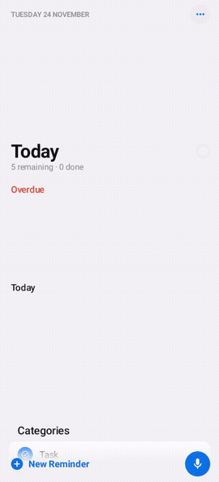
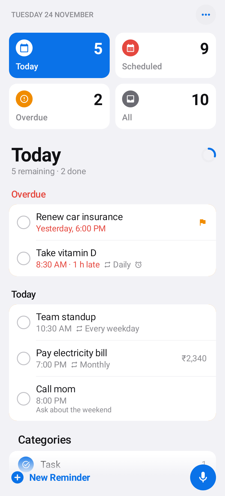
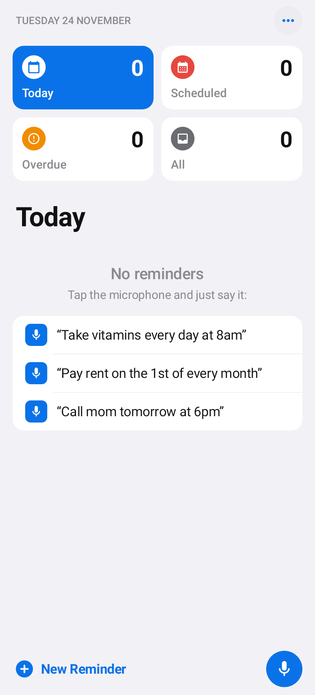
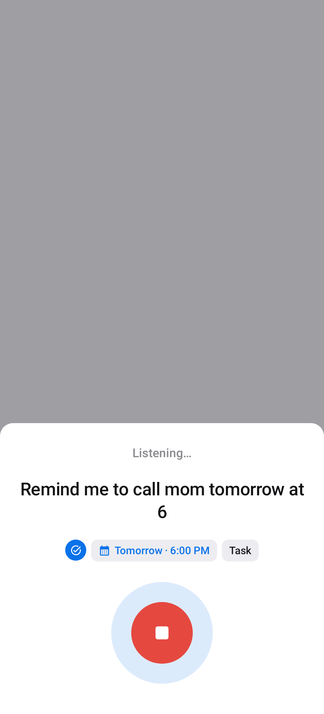
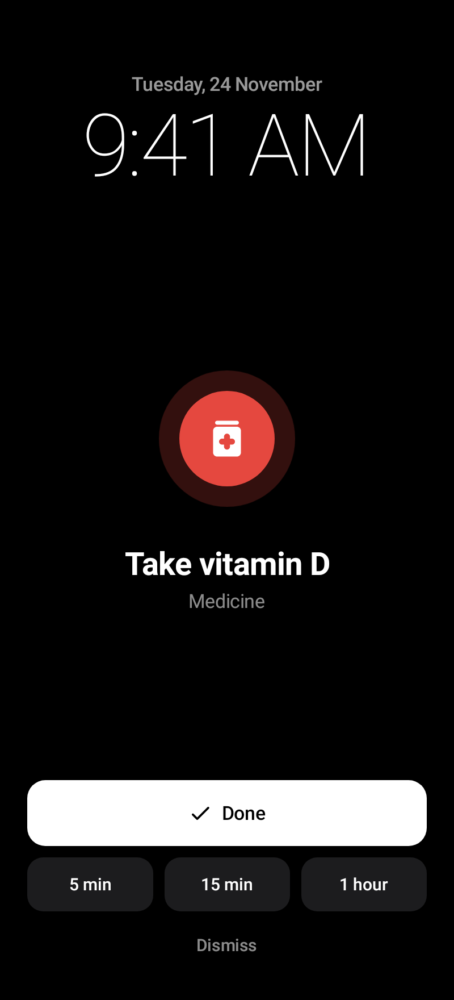
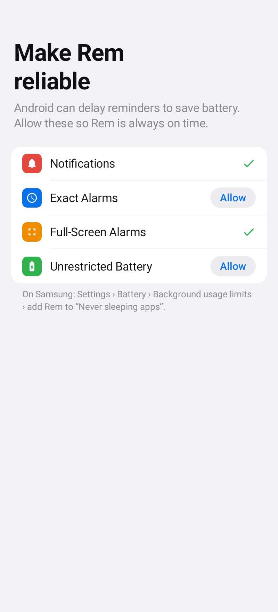

# Rem

**The Android reminder app you can't miss.** Rem combines the best ideas from TickTick, Todoist, Google Tasks, Microsoft To Do, Any.do, BZ Reminder, Galarm, Alarmy and Medisafe in one app that is private, offline and free of AI APIs.

> "If it has a date, a place or a habit, Rem remembers it, and it won't let you forget."

## What's in the v0.1 MVP
- **Type it the way you'd say it:** "pay rent every 1st at 9am !1" or "gym every mon wed fri 7am". A rule-based parser runs on the phone and picks out the date, time, repeat, priority and category.
- **Remind everything:** 13 categories (Task, Work, Medicine, Health, Habit, Bill, Birthday, Event, Document, Vehicle, Home, Pet, Shopping). Each has smart defaults: medicine rings like an alarm and keeps nagging, bills warn you 3 days ahead, birthdays repeat yearly.
- **Reminders you can't miss:** a full-screen alarm over the lock screen with sound and vibration, plus a **"keep reminding me every N minutes"** nag mode.
- **Any repeat:** daily, weekdays, Mon/Wed/Fri, every N weeks, 1st of the month, last day of the month, yearly, all stored as RFC 5545 RRULE.
- **Several alerts per reminder:** at the time, 15 min, 1 h, 1 day, 3 days, 1 week or 30 days before.
- **Snooze** (5 min, 15 min, 1 h, tonight, tomorrow), **swipe to finish** with undo, and **Done/Snooze buttons on the notification**.
- **Home dashboard:** today's progress ring, Overdue/Today/Upcoming counts, a two-week day strip, category filters, and Overdue, Today, Tomorrow, This week, Later and Someday sections.
- **Reliability:** exact alarms, rescheduling after reboot, clock or time-zone changes, a permission setup wizard, and battery-saver tips for each phone brand (Xiaomi, Samsung, OnePlus and others).
- **Share to Rem:** share any text from another app to create a reminder.
- **Voice input** that understands spoken times, plus **home-screen widgets** and launcher shortcuts.
- Light and dark themes, edge-to-edge.

## Design
Clean and minimal: one accent colour, white grouped cards on a soft grey canvas, large bold titles, hairline separators and quiet motion. Colour appears only where it carries meaning: overdue in red, small category glyphs, and done in green. Light and dark themes are included.



| Today | Dark | Scheduled | Empty |
|---|---|---|---|
|  |  |  |  |

| Voice: listening | Voice: understood | Quick add | Details |
|---|---|---|---|
|  |  |  |  |

| Alarm | Onboarding | Just say it | Setup |
|---|---|---|---|
|  |  |  |  |

## Voice
Tap the mic (in the app, the widget, or by long-pressing the app icon) and say it naturally:
"Remind me to call mom tomorrow at 6 pm", "Take my vitamins every day at 8 in the morning", "Pay rent on the first of every month", "Leave for the station at quarter to seven".
The words appear live and Rem shows what it understood (day, time, repeat, category) before you add it. Speech-to-text uses the phone's built-in recogniser, preferring on-device recognition. The understanding is Rem's own rule-based parser, so no AI API is involved.

## Widgets
- **Today** (resizable): today's count, overdue and upcoming reminders, a tick circle to complete one, and buttons to add or say a new reminder.
- **Quick Add** (2×1): a "New" button and a mic.

## Build
Requirements: JDK 17+ and the Android SDK (platform 35).

```bash
./gradlew :core:test                 # parser, recurrence and planner tests (no Android SDK needed)
./gradlew :app:testDebugUnitTest     # Robolectric tests for alarms, notifications and home state
./gradlew :app:assembleDebug         # APK at app/build/outputs/apk/debug/app-debug.apk
./gradlew :app:recordRoborazziDebug  # regenerate docs/screenshots and motion frames
./scripts/make-motion.sh             # turn motion frames into docs/motion/showreel.mp4 + .gif
```

CI (GitHub Actions) runs every test and uploads the debug and release APKs as a build artifact.

## Architecture
```
core/  Pure Kotlin, no Android, fully unit-tested
  model/        Reminder, Category (with smart defaults), Priority, AlertStyle
  recurrence/   RRULE subset engine + human-readable descriptions
  parser/       Rule-based natural-language quick add + keyword category detection
  scheduling/   ReminderPlanner: next alarm, snooze, complete (no drift), nag, DST-safe
app/   Android
  data/         Room database, repository, ReminderService (one place that changes data and alarms together)
  alarm/        AlarmScheduler (exact / alarm-clock / inexact fallback), receivers, Notifier, full-screen AlarmActivity
  ui/           Jetpack Compose: home, quick add, edit, onboarding and setup, theme
  ui/voice/     SpeechController (Android SpeechRecognizer) + voice sheet
  ui/motion/    Quiet motion: press feedback, gentle entrances, rolling counters, shared elements
  widget/       Jetpack Glance widgets (Today, Quick Add)
```

## Docs
- [Full feature catalog](docs/FEATURES.md): everything Rem can remind you about, and how
- [Competitor analysis](docs/COMPETITOR_ANALYSIS.md): feature comparison of the top Android reminder apps
- [Product spec](docs/PRODUCT_SPEC.md): full feature list, tech stack, data model and roadmap
- [v0.1 plan](docs/superpowers/plans/2026-11-24-rem-v0.1-mvp.md)
