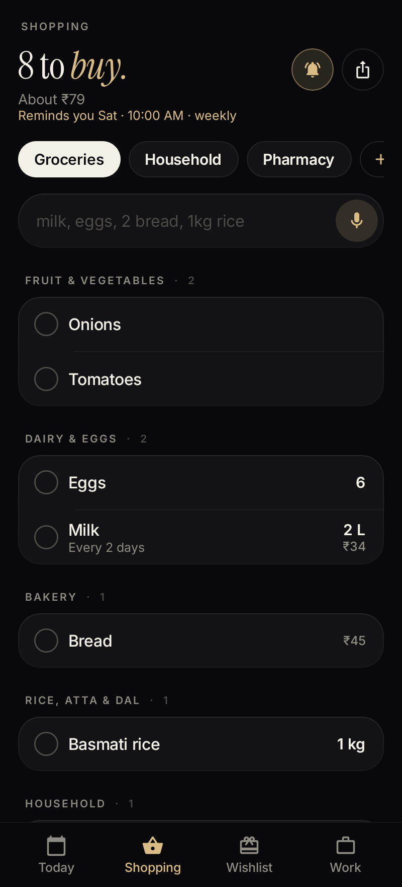
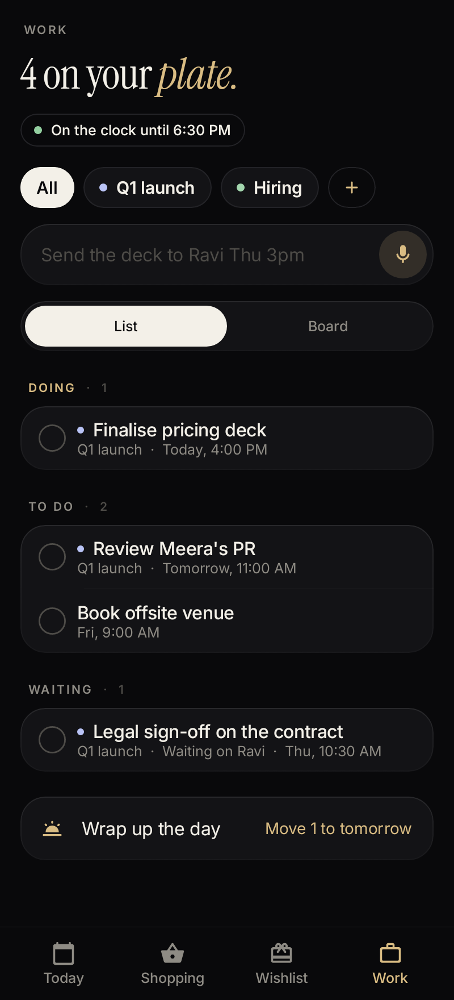
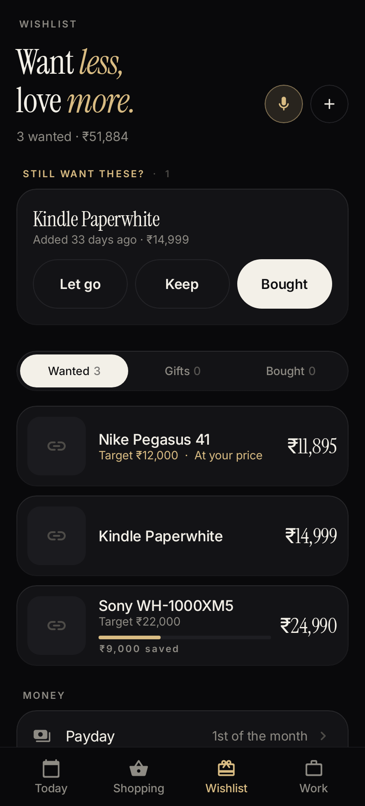
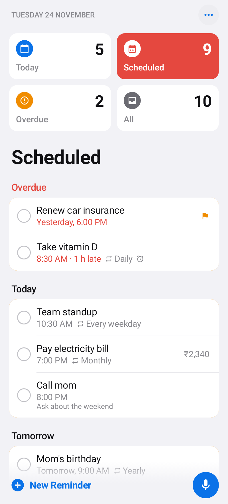
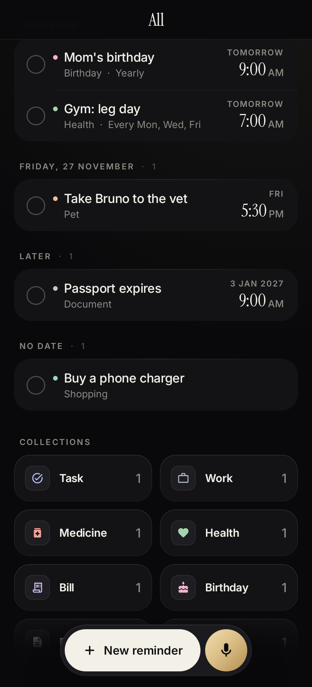
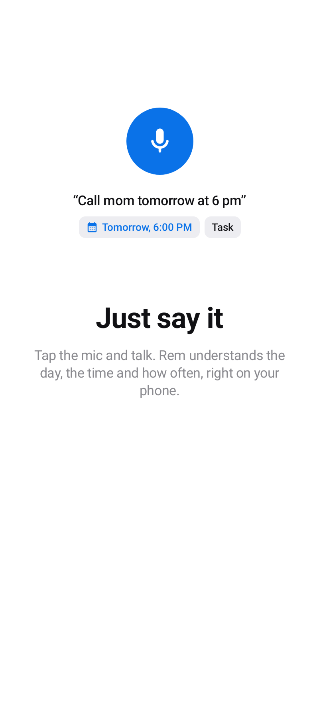
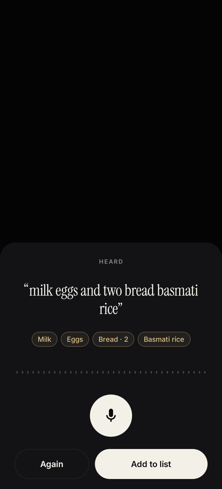

# Rem

**The Android reminder app you can't miss.** Rem combines the best ideas from TickTick, Todoist, Google Tasks, Microsoft To Do, Any.do, BZ Reminder, Galarm, Alarmy and Medisafe in one app that is private, offline and free of AI APIs.

> "If it has a date, a place or a habit, Rem remembers it, and it won't let you forget."

## What's in the v0.1 MVP
- **Type it the way you'd say it:** "pay rent every 1st at 9am !1" or "gym every mon wed fri 7am". A rule-based parser runs on the phone and picks out the date, time, repeat, priority and category.
- **Remind everything:** 13 categories (Task, Work, Medicine, Health, Habit, Bill, Birthday, Event, Document, Vehicle, Home, Pet, Shopping). Each has smart defaults: medicine rings like an alarm and keeps nagging, bills warn you 3 days ahead, birthdays repeat yearly.
- **Reminders you can't miss:** a full-screen alarm over the lock screen with sound and vibration, plus a **"keep reminding me every N minutes"** nag mode.
- **Any repeat:** daily, weekdays, Mon/Wed/Fri, every N weeks, 1st of the month, last day of the month, yearly, all stored as RFC 5545 RRULE.
- **Several alerts per reminder:** at the time, 15 min, 1 h, 1 day, 3 days, 1 week or 30 days before.
- **Snooze** (5 min, 15 min, 1 h, tonight, tomorrow), **swipe to finish** with undo, and **Done/Snooze buttons on the notification**.
- **Home dashboard:** today's progress ring, Overdue/Today/Upcoming counts, a two-week day strip, category filters, and Overdue, Today, Tomorrow, This week, Later and Someday sections.
- **Reliability:** exact alarms, rescheduling after reboot, clock or time-zone changes, a permission setup wizard, and battery-saver tips for each phone brand (Xiaomi, Samsung, OnePlus and others).
- **Share to Rem:** share any text from another app to create a reminder.
- **Voice input** that understands spoken times, plus **home-screen widgets** and launcher shortcuts.
- A premium dark design, edge-to-edge.

## New in v0.3: Shopping, Wishlist and Work spaces
A bottom tab bar keeps four separate spaces: **Today · Shopping · Wishlist · Work**.

| Today | Shopping | Work | Wishlist |
|---|---|---|---|
|  |  |  |  |

- **Shopping:**
  - Lists per shop.
  - Type "milk, eggs, 2 bread, 1kg rice" to add four items with quantities.
  - Items are auto-sorted by aisle.
  - Buy again, staples that come back every N days, "running low", and an estimated total.
  - Share the list to WhatsApp.
  - Reminders **when you arrive at the shop** (the notification lists the items), every Saturday, or when the list gets long.
- **Wishlist:**
  - Share a product from Amazon, Flipkart or Myntra and it lands here with its link and price.
  - A **30-day "still want it?"** check-in.
  - Target price, savings progress, gifts linked to People with a 2-week lead time, and payday and sale-day nudges.
- **Work:**
  - Projects, with To do / Doing / Waiting / Done as a list or board.
  - "Waiting on Ravi" follow-ups after 2 working days.
  - **Work hours:** work reminders stay quiet in the evenings and at weekends.
  - A morning work agenda and an evening wrap-up that moves the rest to tomorrow.

**Alarms fixed:** "Ring as alarm" now really rings, using a looping alarm sound and vibration from a foreground service, whether the screen is on or off. Exact timing uses `USE_EXACT_ALARM`.

## New in v0.2: remind everything, smarter
**Smarter reminders**
- **Only between:** fire only within allowed hours, such as "call the bank" on weekdays 10–4. Reminders outside the window move to the next allowed slot.
- **Several times a day** (8, 2, 8) and **repeat until a date**, for a course of medicine.
- **Random moments:** for example 5 times a day between 9 and 7, different every day so it never fades into the background.
- **Deadline mode:** gentle notifications 7 and 3 days before, and a firm alarm on the day. Early alerts never ring as alarms.
- **Chained follow-ups:** finishing "Book doctor" asks, "What's next: Doctor visit?"
- **Tiny first step**, shown in the notification.
- **Conflict warning:** "4 reminders within 15 minutes. Spread them out?"
- **Snooze learning:** "You usually push Gym to 8:30. Move it?"

**Context triggers**
- **When I plug in tonight**, using WorkManager with a charging constraint.
- **When I wake up**, which follows your phone's next alarm clock, and **before I sleep**.
- **When headphones connect:** Bluetooth anytime; wired headphones while Rem is running.
- **When I leave home**, and **arriving at or leaving a saved place**, using on-device geofences.
- **Don't interrupt me:** holds alarms during calls and (optionally) calendar meetings.

**Life admin (Life hub)**
- **Subscriptions:** monthly and yearly total, renewal dates, "trial ends soon" and cancel-before-renewal.
- **Warranty vault** with receipt photos and expiry alerts.
- **Car service by distance:** km left plus an estimated date from your driving.
- **Plants** with photos, **lend & borrow**, **return windows**, and **rotating family chores** ("Asha's turn").
- One-tap **home and kids essentials**: AC filter, water purifier, gas cylinder, pest control, school fees, vaccinations, exams, PTM.

**People**
- Relationship nudges, such as "You haven't been in touch with Grandma in 2 weeks", with one-tap call and "talked today".
- Gift ideas that surface two weeks before birthdays and anniversaries.
- Anniversary maths ("turns 75", "10th anniversary") and importing birthdays from contacts.
- **Remind someone else:** sends a calendar invite with a built-in alert that works on any phone.

**Motivation, premium & trust**
- Done list, streaks with a weekly freeze, a 14-day heat strip, Year in Rem, and an accountability buddy text you send yourself.
- **Morning Card** (a notification plus a shareable image) and **Focus mode** (just the next three things).
- Accent themes (Gold, Silver, Rose gold, Emerald), an alarm sound per category, and app lock with private reminders.
- Missed-alarm report, nightly local backup, backup and restore files, .ics and PDF export, and **Silence everything** for 1–4 hours.

## Design: Rem Noir
A quiet, premium, dark-first design language:
- **Deep black canvas** with charcoal surfaces lit by a fine highlight along their top edge.
- **Editorial typography:** Instrument Serif for greetings, titles, times and the alarm clock, and Inter for everything you read and tap.
- **Restraint with colour:** ivory for primary actions and champagne gold for progress and selection. Category colours appear only as small muted marks.
- **Considered motion:** sliding segmented controls, a self-drawing gold check, rolling counters, a gold waveform that follows your voice, a breathing glow on the alarm, slide-to-complete, a card-to-details transform, and crisp haptics on every meaningful action.


| Today | Scheduled | All + collections | First run |
|---|---|---|---|
|  |  |  |  |

| Voice: listening | Voice: understood | Quick add | Details |
|---|---|---|---|
|  |  |  |  |

| Alarm | Onboarding | Just say it | Setup |
|---|---|---|---|
|  |  |  |  |

Fonts: [Inter](docs/licenses/Inter-OFL.txt) and [Instrument Serif](docs/licenses/InstrumentSerif-OFL.txt), both under the SIL Open Font License 1.1.

## Voice
Tap the mic (in the app, the widget, or by long-pressing the app icon) and say it naturally:
"Remind me to call mom tomorrow at 6 pm", "Take my vitamins every day at 8 in the morning", "Pay rent on the first of every month", "Leave for the station at quarter to seven".
The words appear live and Rem shows what it understood (day, time, repeat, category) before you add it. Speech-to-text uses the phone's built-in recogniser, preferring on-device recognition. The understanding is Rem's own rule-based parser, so no AI API is involved.

Voice works in every space as well. When the input field is empty, its send button turns into a mic:
- **Shopping:** "milk eggs and two bread basmati rice" adds four separate items (Milk, Eggs, Bread ×2, Basmati rice). Pauses, "and", "also" and quantities mark where items split; known two-word items such as "ice cream" stay together.
- **Work:** "send the deck to Ravi on Thursday at 3" becomes a task due on Thursday at 3 pm.
- **Wishlist:** "Sony headphones for 25,000" opens a wish already filled in with the name and price.



## Widgets
- **Today** (resizable): today's count, overdue and upcoming reminders, a tick circle to complete one, and buttons to add or say a new reminder.
- **Quick Add** (2×1): a "New" button and a mic.

## Build
Requirements: JDK 17+ and the Android SDK (platform 35).

```bash
./gradlew :core:test                 # parser, recurrence and planner tests (no Android SDK needed)
./gradlew :app:testDebugUnitTest     # Robolectric tests for alarms, notifications and home state
./gradlew :app:assembleDebug         # APK at app/build/outputs/apk/debug/app-debug.apk
./gradlew :app:recordRoborazziDebug  # regenerate docs/screenshots and motion frames
./scripts/make-motion.sh             # turn motion frames into docs/motion/showreel.mp4 + .gif
```

CI (GitHub Actions) runs every test and uploads the debug and release APKs as a build artifact.

## Architecture
```
core/  Pure Kotlin, no Android, fully unit-tested
  model/        Reminder, Category (with smart defaults), Priority, AlertStyle
  recurrence/   RRULE subset engine + human-readable descriptions
  parser/       Rule-based natural-language quick add + keyword category detection
  scheduling/   ReminderPlanner: next alarm, snooze, complete (no drift), nag, DST-safe
app/   Android
  data/         Room database, repository, ReminderService (one place that changes data and alarms together)
  alarm/        AlarmScheduler (exact / alarm-clock / inexact fallback), receivers, Notifier, full-screen AlarmActivity
  ui/           Jetpack Compose: home, quick add, edit, onboarding and setup, theme
  ui/voice/     SpeechController (Android SpeechRecognizer) + voice sheet
  ui/motion/    Quiet motion: press feedback, gentle entrances, rolling counters, shared elements
  widget/       Jetpack Glance widgets (Today, Quick Add)
```

## Docs
- [Full feature catalog](docs/FEATURES.md): everything Rem can remind you about, and how
- [Competitor analysis](docs/COMPETITOR_ANALYSIS.md): feature comparison of the top Android reminder apps
- [Product spec](docs/PRODUCT_SPEC.md): full feature list, tech stack, data model and roadmap
- [v0.1 plan](docs/superpowers/plans/2026-11-24-rem-v0.1-mvp.md)
