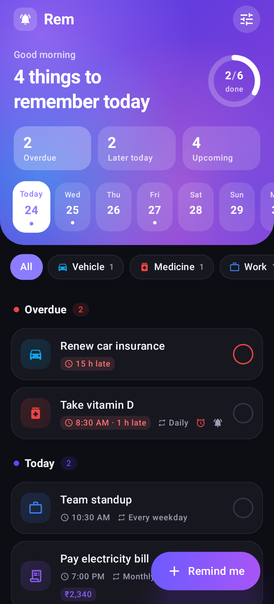
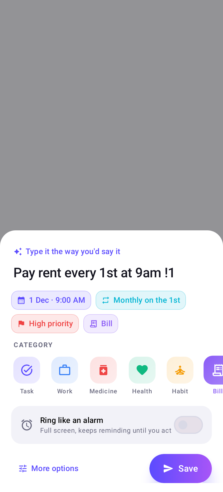
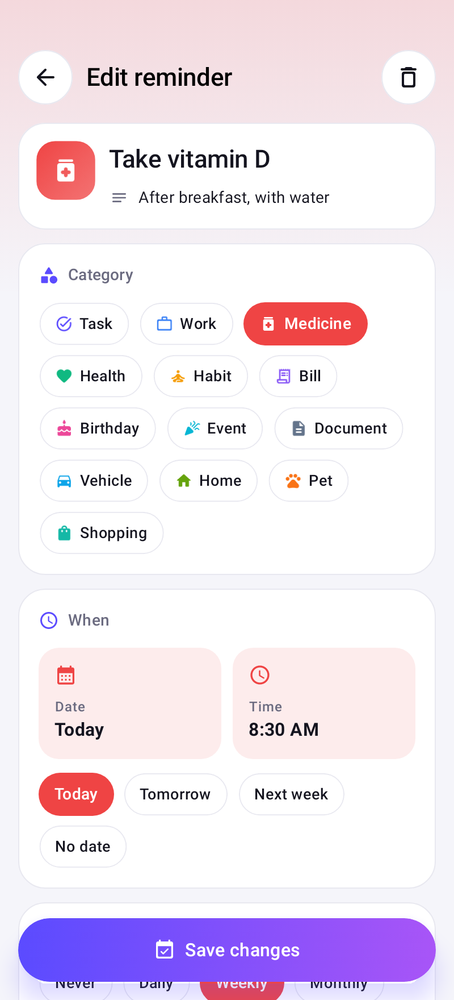
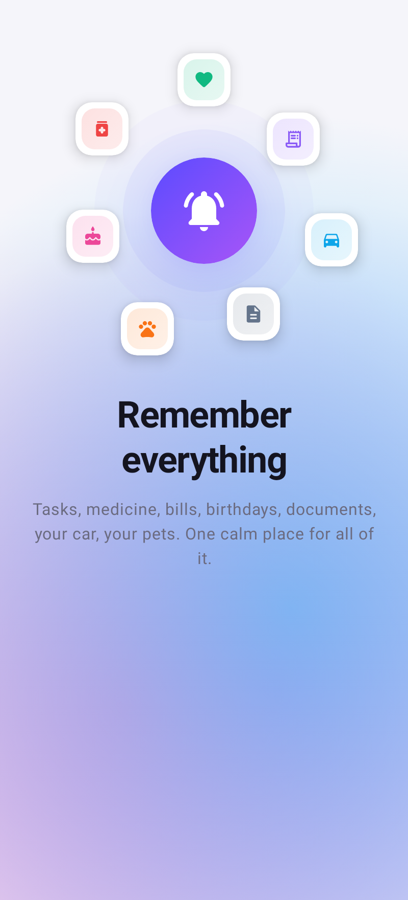

# Rem

**The Android reminder app you can't miss.** Rem combines the best ideas from TickTick, Todoist, Google Tasks, Microsoft To Do, Any.do, BZ Reminder, Galarm, Alarmy and Medisafe in one app that is private, offline and free of AI APIs.

> "If it has a date, a place or a habit, Rem remembers it, and it won't let you forget."

## What's in the v0.1 MVP
- **Type it the way you'd say it:** "pay rent every 1st at 9am !1" or "gym every mon wed fri 7am". A rule-based parser runs on the phone and picks out the date, time, repeat, priority and category.
- **Remind everything:** 13 categories (Task, Work, Medicine, Health, Habit, Bill, Birthday, Event, Document, Vehicle, Home, Pet, Shopping). Each has smart defaults: medicine rings like an alarm and keeps nagging, bills warn you 3 days ahead, birthdays repeat yearly.
- **Reminders you can't miss:** a full-screen alarm over the lock screen with sound and vibration, plus a **"keep reminding me every N minutes"** nag mode.
- **Any repeat:** daily, weekdays, Mon/Wed/Fri, every N weeks, 1st of the month, last day of the month, yearly, all stored as RFC 5545 RRULE.
- **Several alerts per reminder:** at the time, 15 min, 1 h, 1 day, 3 days, 1 week or 30 days before.
- **Snooze** (5 min, 15 min, 1 h, tonight, tomorrow), **swipe to finish** with undo, and **Done/Snooze buttons on the notification**.
- **Home dashboard:** today's progress ring, Overdue/Today/Upcoming counts, a two-week day strip, category filters, and Overdue, Today, Tomorrow, This week, Later and Someday sections.
- **Reliability:** exact alarms, rescheduling after reboot, clock or time-zone changes, a permission setup wizard, and battery-saver tips for each phone brand (Xiaomi, Samsung, OnePlus and others).
- **Share to Rem:** share any text from another app to create a reminder.
- Light and dark themes, Material 3, edge-to-edge.

## Motion


([Full-quality video](docs/motion/showreel.mp4). These are real frames rendered from the app's Compose code, not mock-ups.)

- **Living hero:** an aurora gradient drifts behind the dashboard. It parallaxes and fades as you scroll, and a slim bar slides down in its place.
- **Choreographed entrances:** sections and cards rise in one after another on spring physics.
- **Satisfying completion:** the circle fills, the check mark draws itself, the title gets struck through, confetti bursts, and the list closes the gap with a spring. Finishing everything for today triggers a full-screen celebration.
- **Rolling counters** for every number, a progress ring that sweeps, and an alarm icon that rings on alarm-style cards.
- **Swipe feedback:** the colour deepens and the icon grows as you pull, with a "Done!" label when the swipe is far enough to count.
- **Quick add:** the placeholder types out example sentences, and date, repeat, priority and category chips pop in as Rem understands you.
- **Card to editor:** a shared-element container transform; the category bubble flies into place.
- **Onboarding:** category bubbles orbit a ringing bell, alarm ripples pulse, a demo types itself, and pages slide with parallax.
- **Alarm screen:** a pulsing aurora, a shaking icon, and a glowing, floating Done button.
- Every tap gives press-scale feedback. All looping motion turns off when Android's "Remove animations" setting is on.

## Screenshots
| Home | Dark | Quick add | Edit |
|---|---|---|---|
|  |  |  |  |

| Alarm | Onboarding | Type it | Setup |
|---|---|---|---|
|  |  |  |  |

## Build
Requirements: JDK 17+ and the Android SDK (platform 35).

```bash
./gradlew :core:test                 # parser, recurrence and planner tests (no Android SDK needed)
./gradlew :app:testDebugUnitTest     # Robolectric tests for alarms, notifications and home state
./gradlew :app:assembleDebug         # APK at app/build/outputs/apk/debug/app-debug.apk
./gradlew :app:recordRoborazziDebug  # regenerate docs/screenshots and motion frames
./scripts/make-motion.sh             # turn motion frames into docs/motion/showreel.mp4 + .gif
```

CI (GitHub Actions) runs every test and uploads the debug and release APKs as a build artifact.

## Architecture
```
core/  Pure Kotlin, no Android, fully unit-tested
  model/        Reminder, Category (with smart defaults), Priority, AlertStyle
  recurrence/   RRULE subset engine + human-readable descriptions
  parser/       Rule-based natural-language quick add + keyword category detection
  scheduling/   ReminderPlanner: next alarm, snooze, complete (no drift), nag, DST-safe
app/   Android
  data/         Room database, repository, ReminderService (one place that changes data and alarms together)
  alarm/        AlarmScheduler (exact / alarm-clock / inexact fallback), receivers, Notifier, full-screen AlarmActivity
  ui/           Jetpack Compose: home, quick add, edit, onboarding and setup, theme
  ui/motion/    Motion toolkit: springs, stagger, aurora, confetti, shimmer, counters, shared elements
```

## Docs
- [Full feature catalog](docs/FEATURES.md): everything Rem can remind you about, and how
- [Competitor analysis](docs/COMPETITOR_ANALYSIS.md): feature comparison of the top Android reminder apps
- [Product spec](docs/PRODUCT_SPEC.md): full feature list, tech stack, data model and roadmap
- [v0.1 plan](docs/superpowers/plans/2026-11-24-rem-v0.1-mvp.md)
